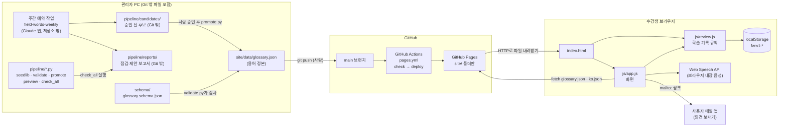
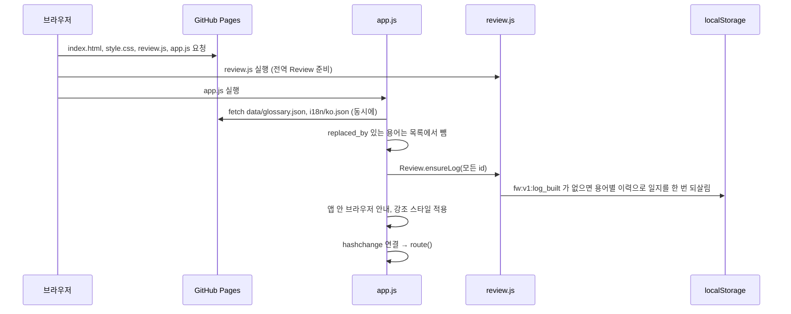

# 아키텍처 (Architecture: 시스템을 이루는 부분과 그 연결)

- 작성일: 2026-11-16 (main `9e08101` 기준 코드를 읽고 씀)
- 결정의 이유는 ADR에 있다. 이 문서는 "지금 어떻게 생겼나"만 적는다.
  - [ADR-0001](adr/0001-정적-사이트와-관리자-파이프라인.md) 정적 사이트 + 관리자 파이프라인
  - [ADR-0003](adr/0003-음성은-브라우저-내장-음성.md) 음성은 브라우저 내장 음성
  - [ADR-0004](adr/0004-운영-자동화는-점검과-제안까지.md) 운영 자동화는 점검과 제안까지
- 데이터의 주인과 정본은 [data-model.md](data-model.md), 기능별 순서는 [flows.md](flows.md)에 있다.

## 1. 한 줄 요약

**관리자 PC가 용어 데이터(`glossary.json`)를 만들고, GitHub가 검사 후 정적 사이트로 배포하고, 수강생 브라우저가 그 파일을 읽어 혼자 동작한다.** 서버(Server: 요청을 받아 처리하는 컴퓨터 프로그램)와 로그인은 없다.

## 2. 구성도

GitHub에서 이 그림이 바로 보인다. Mermaid(글로 그림을 그리는 문법)로 그렸다.

## 3. 구성요소 역할

### 3-1. 관리자 파이프라인 (`pipeline/`, `schema/`) — 관리자 PC에서만 실행

| 구성요소 | 역할 | 입력 → 출력 |
|---|---|---|
| `schema/glossary.schema.json` | `glossary.json`의 모양 규칙. JSON Schema(JSON 모양 검사 규칙) | — |
| `pipeline/validate.py` | 스키마 검사 + 참조 무결성(가리키는 대상이 실제로 있는지) 검사 | glossary.json → 오류·경고 |
| `pipeline/seedlib.py` | 용어 묶음을 glossary.json에 기존 모양 그대로 덧붙인다. 이미 있는 id는 덮어쓰지 않고 멈춘다 | 묶음(TERMS, PAIRS) → glossary.json |
| `pipeline/seeds/*.py` | 이미 넣은 용어 묶음의 기록. `batch_*`는 추가, `update_*`는 수정 | — |
| `pipeline/promote.py` | 승인한 후보 묶음(용어 `TERMS` · 혼동 쌍 `PAIRS` · AI 답 검수 `AI_CHECKS`)을 넣고 검사한다. AI 답 검수는 넣을 때 `recheck_at`을 계산한다. 오류면 원래대로 되돌린다. 성공하면 후보 파일을 `seeds/`로 옮긴다. 커밋은 하지 않는다 | candidates/*.py → glossary.json |
| `pipeline/preview.py` | 후보 묶음을 사람이 읽기 쉬운 `.md`로 만든다 | candidates/*.py → `*_미리보기.md` |
| `pipeline/check_all.py` | 종합 점검 10가지(데이터, 규칙 시험, 비밀 값, 개인정보, 금지 파일, 캐시 버전, 외부 파일, 의존성, 내용 보강, **다시 확인할 AI 답 검수 문제**) | 저장소 → `reports/점검_날짜.md` |
| `pipeline/recheck.py` | AI 답 검수 문제 "다시 확인함"(`--ok`: 확인일 = 오늘, 다시 확인할 날 다시 계산) · "내리기"(`--retire`: `retired_at` = 오늘). 커밋하지 않는다 | 문제 id → glossary.json |
| 주간 예약 작업 `field-words-weekly` | Claude 앱의 예약 작업. 점검·수정 제안·새 용어 후보를 만든다. `site/`를 고치지 않고 커밋·배포하지 않는다 | → candidates/, reports/ |

- 주간 예약 작업의 설정은 저장소 안에 없다. 지침은 [운영_자동화.md](운영_자동화.md)에 있다. 실제 예약 설정과 지침이 같은지는 **확인 필요**.
- `pipeline/visuals/`에는 Mermaid 원본(`.mmd`)이 있다. SVG로 바꾸는 도구는 저장소에 없다(**확인 필요**: 수동 변환인지).

### 3-2. 배포 (`.github/workflows/pages.yml`)

| 단계 | 하는 일 |
|---|---|
| 언제 | `main`에 push할 때, 또는 GitHub 화면에서 손으로 실행할 때 |
| check | `validate.py` → `node --test tests/review.test.js` → `node --check`로 `app.js`·`review.js` 문법 검사 → 통과하면 `site/` 폴더를 배포용 묶음(artifact)으로 올려 둔다 |
| deploy | check가 통과해야만 실행. check가 올려 둔 `site/` 묶음을 GitHub Pages에 배포만 한다 |

- 올리기(check)와 배포(deploy)를 다른 작업으로 나눈 이유: 같은 작업에서 연달아 하면 배포가 방금 올린 묶음을 못 찾는 일이 생겼다(2026-11-24).
- `pipeline/`, `docs/`, `schema/`는 배포되지 않는다. 공개 사이트에는 API 키(Key: 유료 서비스용 비밀 열쇠)가 들어갈 자리가 없다.
- `check_all.py`의 9가지 중 Actions가 돌리는 것은 데이터 검사와 규칙 시험뿐이다. 비밀 값·개인정보 검사는 관리자 PC에서만 돈다.
- 공개 주소는 README에 "[공개 후 채우기]"로 남아 있다. 실제 Pages 주소는 **확인 필요**.

### 3-3. 공개 사이트 (`site/`) — 수강생 브라우저에서 실행

| 파일 | 역할 |
|---|---|
| `index.html` | 뼈대. 맨 위 막대·본문·바닥글 자리만 있다. `review.js`를 먼저, `app.js`를 나중에 부른다. `?v=` 값으로 캐시 버스팅(Cache Busting: 브라우저가 옛 파일을 쓰지 않게 하는 장치) |
| `js/review.js` | 학습 기록과 복습 규칙. 화면이 없다. 전역 `Review`로 공개된다. Node.js 시험에서도 `require()`로 쓴다. AI 답 검수도 여기서 고른다(`planCheck`) · 기록한다(`recordCheck`). 분류 · 상자 규칙은 용어와 같은 함수를 쓴다 |
| `js/app.js` | 화면 전부. 해시 라우팅(Hash Routing: 주소의 `#` 뒤 값으로 화면을 고르는 방식), 검색, 카드, 오늘의 학습, 듣기, 의견, 내 기록 |
| `css/style.css` | 디자인. 혼동 쌍 색 토큰(A 베이지, B 세이지)이 여기 있다 (ADR-0002) |
| `data/glossary.json` | 용어·혼동 쌍 데이터. 관리자 파이프라인과 사이트를 잇는 **유일한 연결 고리** |
| `i18n/ko.json` | 화면 문구. i18n(Internationalization: 여러 언어 지원). 지금은 한국어만 |

`app.js` 안의 화면(주소)은 다음과 같다. 파일 맨 위 주석은 "화면 3개"라고 적혀 있지만 실제는 아래 6개다.

| 주소 | 함수 | 화면 |
|---|---|---|
| `#/` | `renderList` | 목록 · 검색 · 단계 고르기 · 오늘의 학습 진입 |
| `#/term/<id>` | `renderTerm` | 용어 카드. 👀 보기 / 🚶 이동 중 / 🗣 말하기 모드 |
| `#/study` | `renderStudy` → `renderWrap` → `renderStudyDone` | 오늘의 학습 → 오늘의 마무리 → 마침. 하루 1개 AI 답 검수 문제가 3장째 다음에 끼어든다 |
| `#/check/<id>` | `renderCheck` | AI 답 검수 한 문제 (용어 카드의 "AI가 자주 틀리는 것" 링크로 연다) |
| `#/progress` | `renderProgress` | 📈 내 기록 (잔디, 성장 그래프, 백업) |
| `#/feedback/<id?>` | `renderFeedback` | 의견 보내기 |
| `#/about` | `renderAbout` | 정보 · 강조 표시 고르기 · 음성 정보 |

### 3-4. 브라우저 기능 (외부 라이브러리 없음)

| 기능 | 쓰는 곳 |
|---|---|
| `fetch` | glossary.json, ko.json 불러오기 (`cache: "no-cache"`) |
| `localStorage` | 학습 기록. 못 쓰는 환경이면 메모리에 둔다(새로고침하면 사라짐) |
| Web Speech API `speechSynthesis` | 듣기, 이동 중 모드. 기기에서 가장 좋은 음성을 고른다 |
| Wake Lock API | 이동 중 모드에서 화면 켜 두기 |
| Media Session API | 잠금 화면에서 재생·다음·이전 |
| `mailto:` | 의견 보내기. Web3Forms(무료 양식 전송 서비스) 키가 비어 있어 지금은 메일 앱을 연다 |
| Blob 다운로드 · 파일 선택 | 학습 기록 백업 파일 저장·가져오기 |

## 4. 호출 흐름

### 4-1. 사이트가 열릴 때

- 불러오기에 실패하면 "데이터를 불러오지 못했어요" 문구를 보여 준다.

### 4-2. 화면이 바뀔 때 (`route()`)

1. 읽던 음성을 멈추고, 타이머를 끈다.
2. 주소(`location.hash`)를 보고 화면 함수 하나를 부른다.
3. 화면 함수는 `#app` 안을 통째로 다시 그린다(`replaceChildren`).

### 4-3. 화면과 규칙의 경계

- 화면(`app.js`)은 학습 기록을 직접 쓰지 않는다. `Review.record`, `Review.practice`, `Review.setSettings` 등을 부른다.
- 예외: 첫 안내를 봤는지(`fw:v1:notice_seen`)만 `app.js`가 직접 `localStorage`에 쓴다.
- 규칙을 바꾸면 `node --test tests/review.test.js`로 시험한다. 시험은 가짜 저장소(`useStore`)와 가짜 날짜(`useClock`)를 끼워 넣는다.

## 5. 보안 경계

| 경계 | 지키는 방법 |
|---|---|
| API 키 | 공개 사이트에 없다. 키는 `.env`에만 둔다(`.gitignore`). 지금 파이프라인 코드는 `.env`를 읽지 않는다 |
| 승인 전 데이터 | `pipeline/candidates/`, `pipeline/reports/`, `pipeline/inbox/`는 `.gitignore` |
| 개인정보 | 로그인 없음. 학습 기록은 브라우저 밖으로 나가지 않는다. 공개 파일의 전화번호·주민번호 모양은 `check_all.py`가 찾는다 |
| 다른 기획 자료 | `research/`는 저장소 밖. `.gitignore`에 남겨 두고 `check_all.py`가 Git에 있는지 검사 |
| 외부 스크립트 | 외부 서버 스크립트를 불러오지 않는다. `check_all.py`가 검사 |
| 검색 노출 | `index.html`의 `noindex, nofollow`. 넓게 공개할 때 지운다 |
