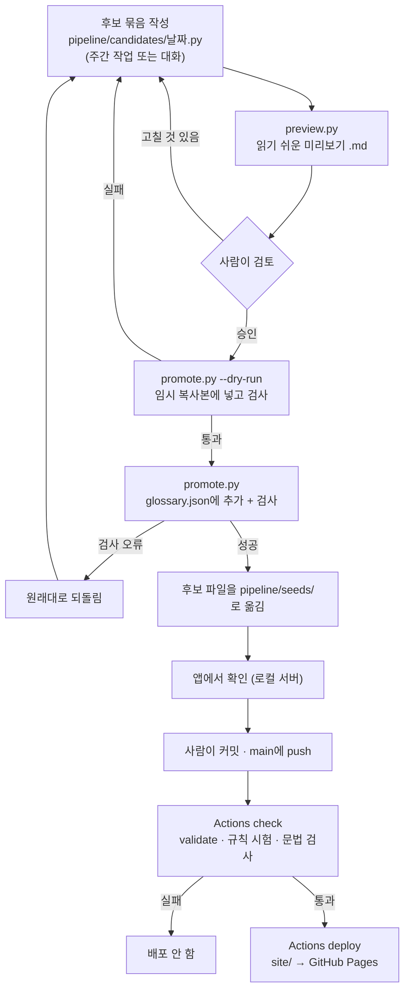
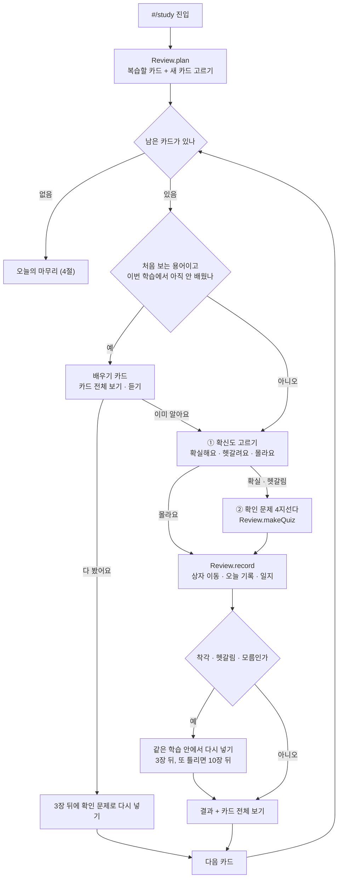
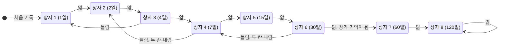
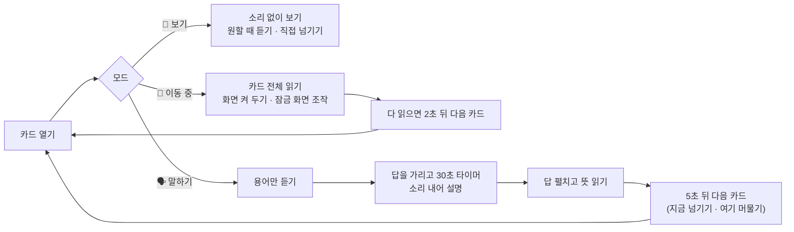
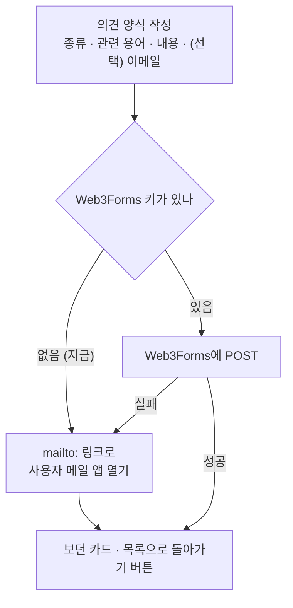
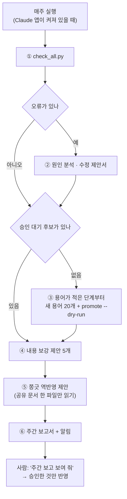
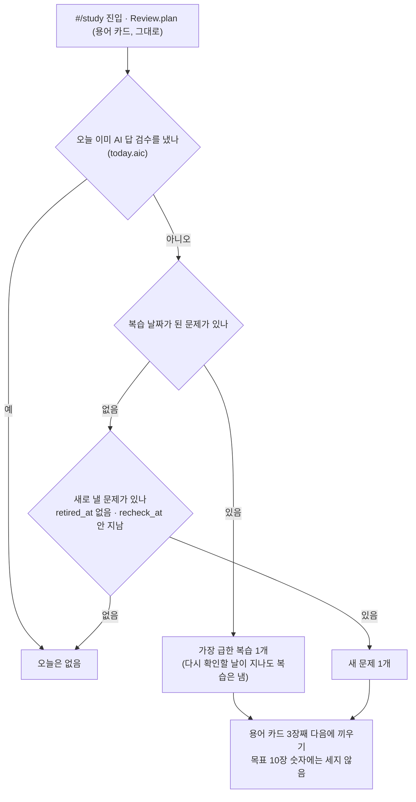
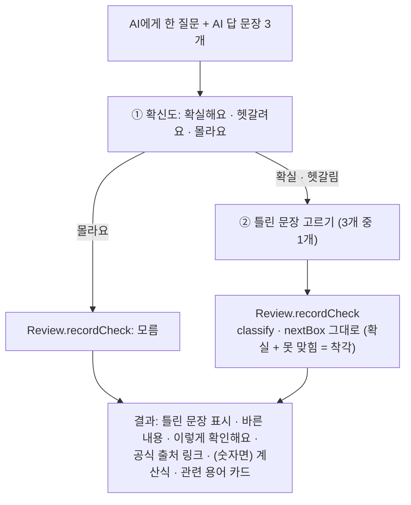
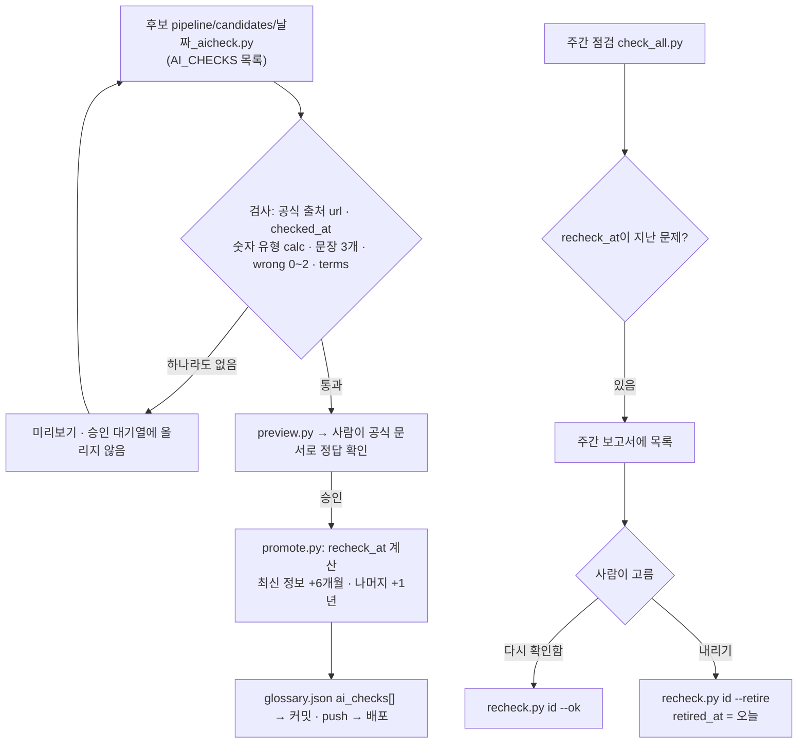

# 흐름 설계 (Flows: 주요 기능이 어떤 순서로 움직이는지)

- 작성일: 2026-11-16 (main `9e08101` 기준 코드를 읽고 씀)
- 구성요소는 [architecture.md](architecture.md), 저장되는 값은 [data-model.md](data-model.md)를 본다.
- 이 앱은 AI 에이전트(Agent: 스스로 도구를 골라 쓰며 일하는 AI 프로그램)가 아니다. 공개 사이트에는 LLM이 없다. LLM이 일하는 곳은 관리자 쪽 주간 예약 작업뿐이라, 그 단계만 7절에 그래프로 그린다.

| # | 흐름 | 주 코드 |
|---|---|---|
| 1 | 새 용어를 공개하기 | `pipeline/preview.py`, `promote.py`, `validate.py`, `pages.yml` |
| 2 | 오늘의 학습 (판단 1번 + 확인 1번) | `app.js` `renderStudy`, `review.js` `plan`·`makeQuiz`·`record` |
| 3 | 복습 상자 이동 | `review.js` `classify`·`nextBox`·`intervalFor` |
| 4 | 오늘의 마무리 | `review.js` `planWrap`·`practice`, `app.js` `renderWrap` |
| 5 | 카드 모드 (보기 · 이동 중 · 말하기) | `app.js` `renderTerm`, `speakPractice`, `speech` |
| 6 | 의견 보내기 · 기록 백업 | `app.js` `renderFeedback`, `backupSection` |
| 7 | 주간 자동 점검 (관리자) | 저장소 밖 예약 작업 + `check_all.py` |
| 8 | AI 답 검수 (2026-11-24) | `review.js` `planCheck`·`recordCheck`, `app.js` `renderCheck`, `pipeline/promote.py`·`recheck.py` |

---

## 1. 새 용어를 공개하기 (사람 승인 게이트)

- 공개 전에는 [공개_체크리스트.md](공개_체크리스트.md)를 확인한다. 특히 "데이터 한계 안내문"을 올렸는지 사람에게 묻는다.
- 이미 공개한 용어를 고칠 때는 `pipeline/seeds/update_*.py`처럼 수정 스크립트를 쓴 기록이 있다. 직접 고칠 때의 절차는 문서에 없다(**확인 필요**).

## 2. 오늘의 학습

카드 하나당 **판단 1번 + 확인 1번**이다(`docs/설계_체크화면.md` A안).

### 2-1. 오늘 카드 고르기 (`Review.plan`)

1. 하루 목표는 기본 10장이다(`daily_goal`). "더 하기"를 누르면 오늘만 늘어난다.
2. 오늘 이미 본 카드는 뺀다.
3. 기록이 없으면 **새 카드**, 복습 날짜(`next_review_at`)가 오늘 이전이면 **복습 카드**다.
4. 복습 카드는 급한 상태 순서(🚨 착각 → 🟠 헷갈림 → ⚪ 모름 → 🟡 불안한 앎 → ✅ 앎)로, 같으면 복습 날짜가 빠른 순서로 정렬한다.
5. 하루 목표의 30%는 새 카드 자리로 남긴다. 단, 밀린 복습이 목표의 2배를 넘으면 새 카드는 1장만.
6. 복습 2장마다 새 카드 1장을 섞는다(교차 학습).

### 2-2. 확인 문제 만들기 (`Review.makeQuiz`)

- 상자 0~2: 용어를 보고 **뜻** 고르기. 상자 3 이상: 뜻을 보고 **용어** 고르기.
- 오답 보기 3개는 이 순서로 채운다: 혼동 쌍 → 같은 단계·같은 등급 → 같은 단계 → 나머지.
- 틀린 보기를 고르면 그 용어 id를 `confused_with`로 기록한다.

## 3. 복습 상자 이동 (라이트너 상자)

라이트너 상자(Leitner Box: 맞히면 다음 상자로, 틀리면 앞 상자로 옮겨 복습 간격을 늘리는 방법)를 쓴다.

### 3-1. 5단계 상태 (`classify`)

| 확신도 \ 정답 | 맞음 | 틀림 |
|---|---|---|
| 확실해요 | ✅ 앎 `known` | 🚨 착각 `misconception` |
| 헷갈려요 | 🟡 불안한 앎 `shaky` | 🟠 헷갈림 `confused` |
| 몰라요 | — | ⚪ 모름 `unknown` (문제 없이 바로 기록) |

### 3-2. 상자 규칙 (`nextBox`, `intervalFor`)

| 상자 | 1 | 2 | 3 | 4 | 5 | 6 | 7 | 8 |
|---|---|---|---|---|---|---|---|---|
| 다음 복습까지(일) | 1 | 2 | 4 | 7 | 15 | 30 | 60 | 120 (장기 기억 유지) |

- ✅ 앎: 한 칸 올린다(최대 8).
- 🟡 불안한 앎: 그 자리에 둔다(같은 간격으로 한 번 더).
- 🟠 헷갈림 · 🚨 착각 · ⚪ 모름: 상자 4 이상이면 **두 칸만** 내리고, 그 아래면 상자 1로.
- 상자 6 이상에서 맞히면 처음 한 번 `long_term_at`(장기 기억이 된 날)을 남긴다.
- 상자 4 이상에서 틀리면 `lapses`(잊은 횟수)를 1 올린다.
- 그림은 대표 이동만 그렸다. 정확한 규칙은 위 목록과 `review.js`가 기준이다.

## 4. 오늘의 마무리

오늘 할 카드를 다 하면 2~3분 동안 "다시 읽기"가 아니라 "다시 떠올리기"를 한다.

1. `Review.planWrap`이 카드를 고른다: 🚨 착각 → 🟠 틀림(합쳐 최대 3장) → 혼동 쌍이 있는 오늘 용어 1장 → 맞힌 카드 2장.
2. 순서를 섞되, **마지막은 맞힌 카드**로 끝낸다(피크엔드 법칙: 끝 경험이 전체 인상을 정한다).
3. 틀린 것이 없고 본 카드가 3장보다 적으면 건너뛴다.
4. 문제는 한 칸 쉬운 "용어 → 뜻" 형식이다.
5. 결과는 `Review.practice`로 **오늘 기록과 일지에만** 남긴다. 복습 상자는 바꾸지 않는다(같은 날 두 번 올리면 간격 반복이 무너진다).
6. 틀리면 마무리 끝(마지막 맞힐 카드 앞)에 한 번 더 낸다.
7. 끝나면 `markWrapped`로 마무리한 카드를 표시하고 마침 화면으로 간다.

## 5. 카드 모드 (`#/term/<id>`)

- 모드는 이번 학습 동안만 유지된다. 새로고침하면 보기로 돌아간다(저장하지 않음).
- 이동 중 모드로 끝까지 들은 새 용어는 오늘의 학습에서 배우기 카드를 건너뛰고 바로 확인 문제로 간다(`state.heard`, 기록 아님).
- 이름이 바뀐 용어(`replaced_by`)의 옛 주소로 오면 새 용어 주소로 보낸다.

## 6. 의견 보내기 · 기록 백업

### 6-1. 의견 보내기 (`#/feedback`)

- 지금 `app.js`의 `FEEDBACK.accessKey`는 빈 값이다. 그래서 의견은 항상 메일 앱으로 간다.
- 메일 제목에는 "[필드워드 의견]"이 붙는다. 운영 쪽은 이 제목으로 의견 메일을 고른다([운영_자동화.md](운영_자동화.md) 5절).

### 6-2. 기록 백업 (`#/progress` 아래)

1. **저장**: `Review.exportAll()`이 `fw:`로 시작하는 값을 모두 묶어 `fieldwords-backup-날짜.json`으로 내려받는다.
2. **가져오기**: 파일을 고르고 확인을 누르면 `Review.importAll()`이 검사한다. 앱 이름·형식 번호가 다르거나 깨진 값이 하나라도 있으면 **아무것도 바꾸지 않는다**. 통과하면 값을 덮어쓰고 화면을 다시 그린다.

## 7. 주간 자동 점검 (관리자 쪽, LLM 사용)

저장소 밖의 Claude 앱 예약 작업 `field-words-weekly`가 한다. 지침은 [운영_자동화.md](운영_자동화.md), 결정은 [ADR-0004](adr/0004-운영-자동화는-점검과-제안까지.md)에 있다.

- 하지 않는 일: `site/` 고치기, 커밋·푸시·배포, 파일 지우기, 메일·메시지 보내기, 라이브러리 버전 올리기.
- 결과물(`pipeline/reports/`, `pipeline/candidates/`)은 Git에 올리지 않는다.
- 예약 작업의 실제 프롬프트는 저장소 밖에 있어 이 문서와 같은지 **확인 필요**.

## 8. AI 답 검수 (2026-11-24 · 요구 [requirements.md](requirements.md) · 설계 결정 D-1~D-6 사용자 승인)

AI가 쓴 짧은 답 문장 3개 중 틀린 1개를 고른다. 판단 1번(확신도) + 확인 1번(고르기)은 용어 카드와 같다.

### 8-1. 오늘의 학습에 섞기 (`Review.planCheck`, AC-01 · AC-13)

- **하루 1개**: 새 문제와 복습 문제를 합쳐 하루 1개 (사용자 승인 2026-11-24).
- 복습 순서는 용어와 같다: 🚨 착각 → 🟠 헷갈림 → ⚪ 모름 → 🟡 불안한 앎 → ✅ 앎, 같으면 복습 날짜가 빠른 것.

### 8-2. 한 문제 풀기 (`#/check/<id>` 또는 오늘의 학습 안, AC-03~07)

- 빨간 ✗를 쓰지 않는다(Must #16). 고른 번호는 기록에 남긴다.
- **용어 카드 링크로 열었을 때**(D-5): 처음 푸는 문제이거나 복습 날짜가 된 문제만 기록한다. 그 밖에는 연습(기록 없음).
- 용어 카드에는 이어진 문제 1개만 링크한다: 안 푼 것 → 복습 날짜가 된 것 → 가장 오래 전에 푼 것.

### 8-3. 문제 공개 · 다시 확인 (관리자, AC-10~17)

