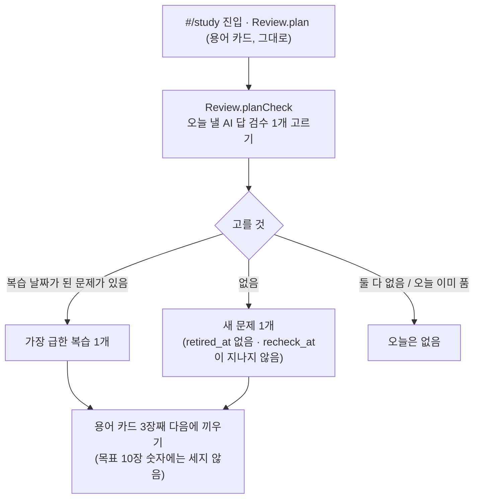
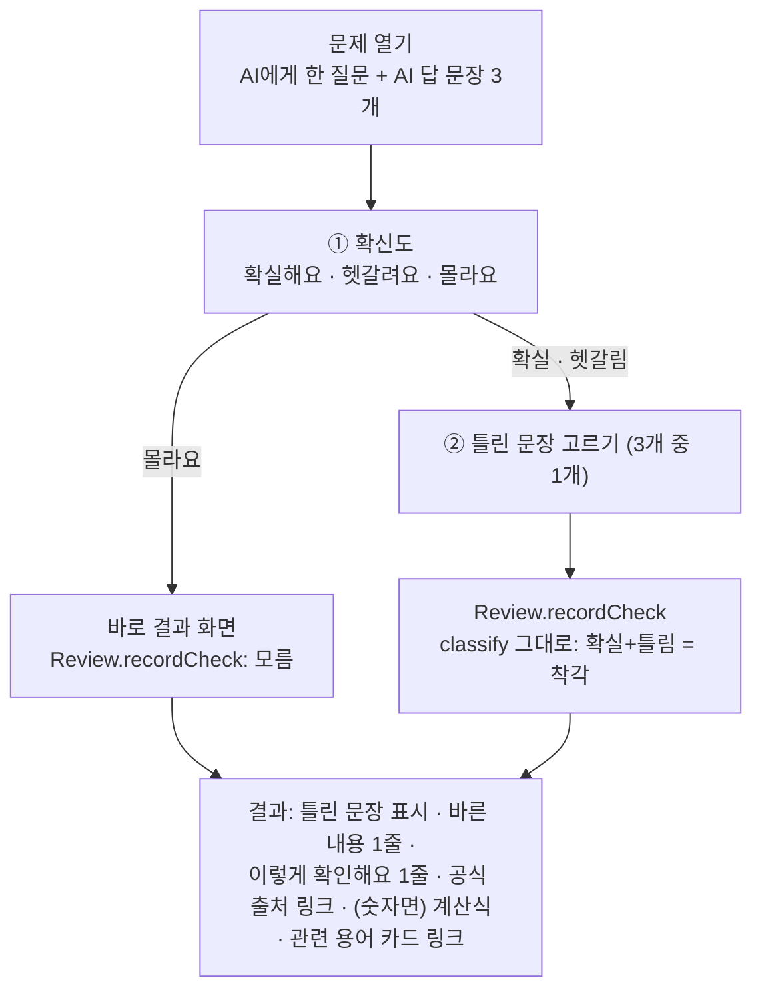
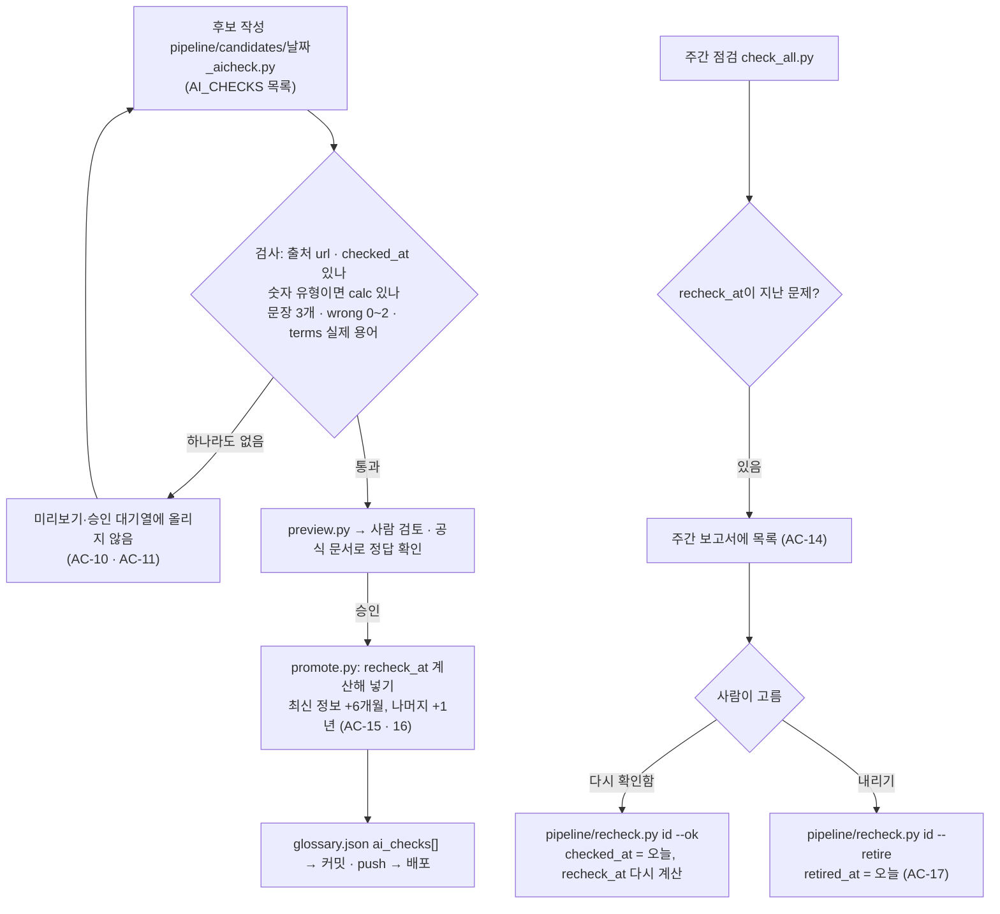

# 설계안 — AI 답 검수 (승인 대기)

> 상태: **제안 · 사용자 승인 대기** · 2026-11-24
> 근거: [requirements.md](requirements.md) 1-1절 · 2절(Q1~Q8) · 4절(AC-01~19). 이 문서는 요구를 바꾸지 않는다.
> 승인되면 이 내용을 [architecture.md](architecture.md) · [data-model.md](data-model.md) · [flows.md](flows.md)에 나눠 넣고, 이 파일은 지운다(같은 커밋).
> 표시: **[정할 것 D-n]** = 요구 5절에서 "설계 때 정한다"고 남긴 칸. 추천과 이유를 붙였다.

---

## 0. 정할 것 한눈에 보기

| # | 정할 것 | 추천 | 이유 | 관련 |
|---|---|---|---|---|
| D-1 | 문제 데이터를 어디에 둘까 | **`glossary.json` 안에 새 목록 `ai_checks[]`** (스키마 1.1 → 1.2) | CLAUDE.md 확정 결정 "관리자 파이프라인과 사이트를 잇는 것은 `glossary.json` 하나뿐"을 그대로 지킨다. 새 파일을 만들면 이 결정을 바꾸는 ADR이 필요하다 | 5절 "데이터 파일 모양 · 위치" |
| D-2 | 하루 1문제와 하루 목표 10장의 관계 | **목표 10장에 넣지 않고 따로 더한다** (가정 AS-2 그대로). 위치는 오늘 카드 **3장째 다음**에 끼운다 | Q2 "10장을 밀어내지 않는다". Q1 "오늘의 학습에 섞는다" → 맨 끝이 아니라 중간에 섞어야 지루함이 준다. 3장째는 새 용어 "배우기 카드"를 다시 묻는 간격과 같아 흐름이 익숙하다 | AS-2 · AC-01 |
| D-3 | 복습 간격 | **용어 카드와 같은 간격**(1·2·4·7·15·30·60 + 120일) (가정 AS-3 그대로) | 규칙이 하나여야 시험과 설명이 쉽다. 20문제라 간격이 길어도 하루 새 문제 1개가 따로 있어 빈 날이 생기지 않는다 | AS-3 · AC-07 |
| D-4 | 학습 기록 저장 이름 | **`fw:v1:aic:<문제 id>`** 새 이름. 일지(`fw:v1:log`)에는 날짜마다 `aic[]` · `aic_misconceptions[]` 칸을 더한다 | 용어 기록(`fw:v1:review:`)과 섞이면 "오늘 n / 10장"과 내 기록의 "본 용어" 숫자가 틀어진다(D-2와 맞물림). 접두어가 `fw:`라 기존 백업 · 가져오기가 그대로 담는다 | AC-07 · AC-18 |
| D-5 | 용어 카드에서 링크로 열었을 때 기록 | **처음 푸는 문제이거나 복습 날짜가 된 문제만 기록**, 나머지는 연습(기록 없음) | "들은 카드 바로 확인하기"(2026-11-13)와 같은 규칙. 미리 맞히면 간격이 무너진다 | AC-08 |
| D-6 | 내리기(`AC-17`)를 데이터에서 어떻게 | 지우지 않고 **`retired_at`(내린 날)** 칸을 적는다. 사이트는 목록과 링크에서 뺀다 | 용어의 `replaced_by`와 같은 원칙: 지우면 수강생 브라우저의 기록이 갈 곳을 잃는다 | AC-17 |

**"틀린 곳 없음" 보기**는 요구(Q4)대로 다음 묶음으로 미룬다. 이번 설계에 넣지 않는다.

---

## 1. 데이터 (→ data-model.md)

### 1-1. 모양 (D-1)

```
glossary.json
├── schema_version   "1.2"           ← ai_checks 추가로 올림 (칸 추가 = 1.x)
├── terms[] / confusable_pairs[]     ← 그대로
└── ai_checks[]                      ← 새로
    ├── id            "rate-limit-per-second"   ← 슬러그, 바꾸지 않는다
    ├── type          number | recency | fact | code          ← 유형 4가지 (1-1)
    ├── prompt        "호출 한도를 어떻게 잡아야 하나요?"       ← 사용자가 AI에게 한 질문
    ├── statements[]  문장 3개 (정확히 3개)                    ← AC-02
    ├── wrong         0 | 1 | 2  ← 틀린 문장 번호 = 정답       ← AC-02
    ├── correction    바른 내용 1줄                            ← AC-05
    ├── how_to_check  확인 방법 1줄                            ← AC-05
    ├── calc?         계산식 (type = number 이면 필수)          ← AC-11
    ├── sources[]     { label, url, checked_at } 1개 이상       ← AC-05 · AC-10
    ├── checked_at    "2026-11-24"  ← 사람이 공식 출처로 확인한 날  ← AC-10
    ├── recheck_at    "2027-05-24"  ← 파이프라인이 계산해 넣음     ← AC-15 · AC-16
    ├── terms[]       관련 용어 id 1개 이상                     ← AS-4 · AC-08
    ├── retired_at?   내린 날 (있으면 공개 목록에서 뺌)          ← D-6 · AC-17
    └── created_at / updated_at
```

- 승인 상태 칸은 두지 않는다(용어와 같다). 파일에는 승인된 문제만 들어간다 → AC-12.
- `statements`·`correction`·`how_to_check`는 새로 쓴 문장. 출처 문장을 복사하지 않는다(이어받는 칸: 저작권).

### 1-2. 정본 표에 더할 줄

| 데이터 | 정본 | 주인 | 사본 · 파생 |
|---|---|---|---|
| AI 답 검수 문제 | `site/data/glossary.json`의 `ai_checks[]` | 관리자. 사람 승인 뒤 파이프라인이 쓴다 | 배포된 파일, `app.js` 메모리 |
| 다시 확인할 날 `recheck_at` | 같은 곳 (파생값이지만 저장) | 파이프라인만 계산해 쓴다(사람이 손으로 쓰지 않음) | 주간 점검 보고서의 목록 |
| AI 답 검수 학습 기록 | 각 브라우저 `fw:v1:aic:<id>` | 수강생 본인. 코드는 `review.js`만 | 백업 파일(기존 `fw:` 묶음에 자동 포함) |

### 1-3. 브라우저 저장 이름 (D-4)

```
fw:v1:aic:<문제 id>   { box, status, first_at, last_at, next_review_at, history[최근 20개] }   ← 용어 기록과 같은 모양
fw:v1:log            날짜마다 aic[] · aic_misconceptions[] 칸 추가 (기존 칸은 그대로)
fw:v1:today          aic: "<오늘 낸 문제 id>" 한 칸 추가 (하루 1개 확인용)
```

---

## 2. 흐름 (→ flows.md 새 절 "8. AI 답 검수")

### 2-1. 오늘의 학습에 섞기 (D-2 · AC-01 · AC-13)



- **하루 1개**: 새 문제와 복습 문제를 합쳐 하루 1개만 낸다(`fw:v1:today.aic`). AC-01 "새 문제를 최대 1개"를 지키면서 복습도 매일 흐름에 남긴다.
  - **확인 필요(요구와 맞는지)**: AC-01은 "새 문제 최대 1개"라 복습 문제는 따로 더 내도 된다고 읽을 수도 있다. 추천은 "합쳐 1개"(하루 부담을 늘리지 않음). 아니면 "새 1개 + 복습은 날짜 된 것 모두".
- **다시 확인할 날이 지난 문제**: 새 문제로는 내지 않고(AC-13), 이미 푼 사람에게는 복습으로 그대로 낸다.

### 2-2. 한 문제 풀기 (AC-03~06)



- 상태 분류(`classify`)와 상자 이동(`nextBox`)은 용어 카드 것을 **그대로** 쓴다. 새 규칙을 만들지 않는다.
- 틀린 보기를 고르면 고른 번호를 기록한다(착각 패턴을 나중에 볼 수 있게).
- 결과 화면은 빨간 ✗를 쓰지 않는다(기존 피드백 규칙 Must #16).

### 2-3. 용어 카드 링크 (AC-08 · D-5)

- 용어 카드에 그 용어와 이어진 문제가 있으면 "AI가 자주 틀리는 것" 줄 1개를 보여 준다 → `#/check/<문제 id>`.
- 문제가 여러 개면 아직 안 푼 것 → 복습 날짜가 된 것 → 가장 오래 전에 푼 것 순으로 1개를 고른다.
- 기록 규칙은 D-5.

### 2-4. 문제를 공개하기 · 다시 확인하기 (관리자, AC-10~17)



---

## 3. 구성요소 (→ architecture.md)

| 구성요소 | 바뀌는 것 |
|---|---|
| `schema/glossary.schema.json` | `ai_checks` 정의 추가, `schema_version` 1.2 |
| `pipeline/validate.py` | 참조 검사 추가: `terms[]`가 실제 용어인가, `wrong`이 0~2인가, 숫자 유형에 `calc`, 출처 1개 이상 · `checked_at` (스키마로 못 잡는 것) |
| `pipeline/seedlib.py` · `promote.py` · `preview.py` | 후보 파일의 `AI_CHECKS` 목록도 읽고 넣기 · 미리보기. 넣을 때 `recheck_at` 계산 |
| `pipeline/recheck.py` (새로) | "다시 확인함"(`--ok`) · "내리기"(`--retire`). 커밋하지 않는다 |
| `pipeline/check_all.py` | 10번째 점검 "다시 확인할 날이 지난 문제" → 보고서 (AC-14) |
| `site/js/review.js` | `planCheck`, `recordCheck`, `getCheck` 추가. `classify` · `nextBox` · `intervalFor`는 그대로 재사용 |
| `site/js/app.js` | 오늘의 학습에 끼우기, 문제 화면(`#/check/<id>`), 용어 카드 링크 |
| `site/i18n/ko.json` | 화면 문구 (`check.ai.*`) |
| `tests/review.test.js` | AC-01 · 04 · 06 · 07 · 13 시험 |
| 새 시험 `tests/pipeline` (Python) | AC-10 · 11 · 14 · 15 · 16 · 17 (검사 도구 시험) |

- 외부 라이브러리 · 서버 · 외부 전송 없음 그대로 → AC-18.
- 화면(`app.js`)은 기록을 직접 쓰지 않는다. `Review.recordCheck`만 부른다(기존 경계 그대로).

---

## 4. 수용 기준 → 설계 · 시험 대응

| AC | 설계 위치 | 시험 |
|---|---|---|
| 01 | 2-1 `planCheck`, `today.aic` | 단위: 같은 날 두 번 불러도 1개 |
| 02 | 1-1 `statements` 3개 · `wrong` | 스키마 + validate |
| 03 | 2-2 ① | 화면: 확신도 전 문장 버튼 없음 |
| 04 | 2-2 몰라요 | 단위: 모름 기록, 문장 고르기 없음 |
| 05 | 2-2 결과 화면 | 화면 |
| 06 | 2-2 `classify` | 단위: 확실+틀림 = 착각 |
| 07 | D-3 `nextBox` 재사용 | 단위: 날짜 바꿔 다시 나옴 |
| 08 | 2-3 | 화면 |
| 09 | 첫 묶음 20개(유형마다 5) | validate에 개수 점검(정보) |
| 10 · 11 | 2-4 검사 | Python 시험 |
| 12 | 1-1 승인된 것만 파일에 | 데이터 검사 |
| 13 | 2-1 `recheck_at` 지남 | 단위(날짜 바꾸기) |
| 14 | check_all 10번째 | Python 시험 |
| 15 · 16 | promote가 계산 | Python 시험 |
| 17 | recheck.py | Python 시험 |
| 18 | 외부 전송 없음 | 네트워크 기록 점검 |
| 19 | 의견 보내기 종류에 "AI 답 검수 정답 오류" 추가 | "의견 보내기" 기록 확인 |

## 5. 만들 순서 (승인 뒤)

1. 설계 문서 3종에 이 내용 반영 + 이 파일 지우기 (한 커밋)
2. 스키마 · validate · 파이프라인(넣기 · 미리보기 · 다시 확인) + Python 시험
3. `review.js` 규칙 + 단위 시험
4. 화면(`app.js`, 문구) + 화면 시험
5. 첫 묶음 20개 후보 → 미리보기 → 사람이 공식 문서로 확인 · 승인 → 공개
